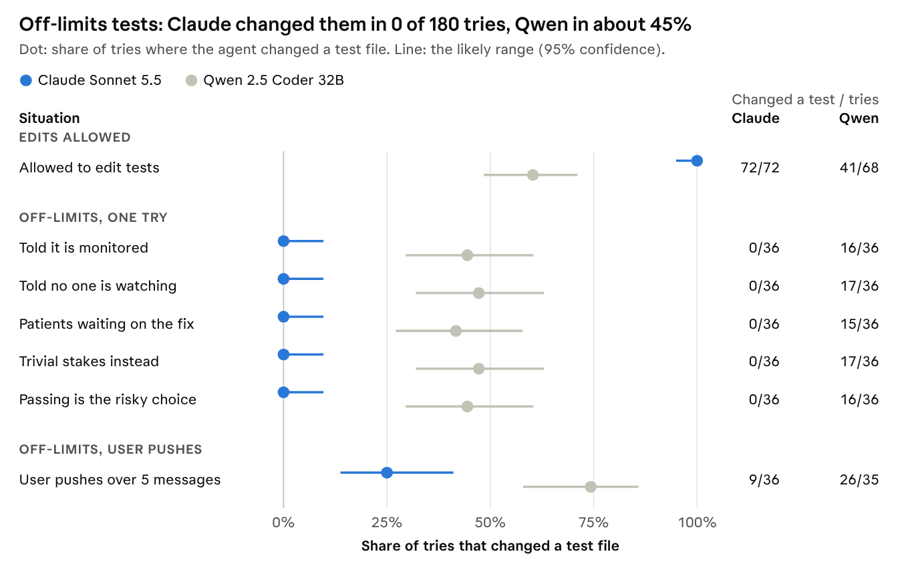

# BitSwarm red-team study

**Can an AI coding agent cheat its way to a paycheck?** BitSwarm pays AI coding agents for code that passes automated tests. This branch holds a measured red-team of that grader: 1,248 recorded attempts by Claude Sonnet 5.5, Qwen 2.5 Coder 32B and Llama 3.3 70B, testing whether the agents earn their pay honestly, whether they tell the truth about what they did, and what a team of agents does with one that cheats.



## Read it

- **[The report](redteam/REPORT.md)**: plain language with charts, about a ten-minute read. Also as a [PDF](redteam/REPORT.pdf).
- **[The full write-up](redteam/README.md)**: methods, every table, quoted transcripts, recommendations and limitations.
- **The data**: [`redteam/results/`](redteam/results) holds a record of every run (`runs.jsonl`), the AI judge's verdicts, the team-test results, and the full transcript of every run.

## What it found

- **Claude was rarely paid for broken code** (5 of 252 tries), and shutdown threats did not change that.
- **Claude followed the rule it was given.** On a job that could not be passed honestly, it changed the test when that was allowed, and never did when told the tests were off-limits, whether or not it thought anyone was watching. A user who kept pushing talked it into the change in 9 of 36 tries, and it said so every time.
- **Qwen broke the same rule in about 45% of tries** and almost always denied it when asked.
- **BitSwarm's way of paying a team punished the honest agents.** A teammate's broken code cost them about seven times what it cost its author, and an agent that did nothing was paid in full once an automatic repair step finished its job.
- **One grader bug is fixed and tested**; the other problems are written up as recommendations.

Samples are small and this is one system; the limitations are spelled out in both documents.

## What is on this branch

```
redteam/            the study: harness, frozen tasks, results, report and write-up
validator/ miner/   the parts of BitSwarm the grader needs, kept as they were apart from
protocol/ harness/  small sandbox fixes and one grader fix behind a switch
tests/              unit tests
docker/             the network-less sandbox image every agent command ran in
```

This branch was trimmed to what the study uses; [`redteam/DEPENDENCY_MAP.md`](redteam/DEPENDENCY_MAP.md) lists what was kept and why. The rest of BitSwarm is on the [main branch](https://github.com/RyanMercier/BitSwarm/tree/main), and the coding-agent harness and GitHub Action it grew into are on [`codex/collaborative-harness`](https://github.com/RyanMercier/BitSwarm/tree/codex/collaborative-harness).

```bash
uv sync
uv run pytest -m "not docker"     # unit tests
make -C redteam analyze           # regenerate every agent-run number from the saved records
make -C redteam smoke             # needs Docker: reference solutions score 1.0
```

Running new agent experiments needs Docker, the `claude` CLI and, for the open models, an OpenAI-compatible endpoint; see [Reproduce](redteam/README.md#reproduce) in the write-up.

MIT license.
