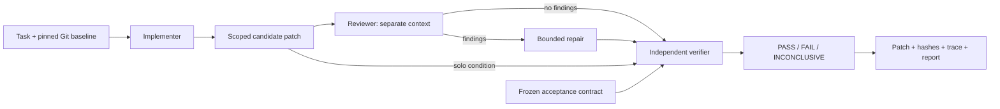

# BitSwarm

**A coding-agent harness that turns model actions into scoped patches, verifies them against frozen tests in a sandbox, and records enough evidence that anyone can rerun the verdict.**

Python 3.11+ | Linux/WSL | Docker | SQLite | Git | Claude CLI and OpenAI-compatible adapters

[](https://github.com/RyanMercier/BitSwarm/actions/workflows/harness.yml)
[](LICENSE)

## The result that matters

Six coding-agent runs passed every acceptance test. Then I audited the reviewer's repair on one of them and found it was wrong for inputs the tests never covered. Five extra probes failed four times on the solo patch and twice on the reviewed patch. Both had been "verified."

That is the project in one paragraph: the interesting engineering is not getting an agent to pass tests. It is knowing what a passing test proves, keeping the evidence when it proves less than you hoped, and making the whole chain replayable. Read the [case study](docs/CASE_STUDY.md), the [post-hoc audit](docs/evidence/pilot/posthoc-audit.json), and the [follow-up under a stronger contract](docs/evidence/followup/README.md).

## What it is for

- **Measuring whether a second agent is worth it.** Run the same task with a solo implementer and with an implementer plus an independent reviewer, under equal budgets, and get acceptance rate, model calls, latency, and cost per accepted task with failures kept in the denominator.
- **Verifying a patch without a model.** `bitswarm verify` takes a repository commit, a patch, an allow list, and a directory of acceptance tests, and returns PASS, FAIL, or INCONCLUSIVE from a network-less container. The same gate ships as a GitHub Action for agent-written pull requests. This is the reusable slice: it does not care who or what wrote the patch.
- **Studying harness design.** Scoped JSON tools instead of a shell, transactional state, fail-closed recovery, three-way verification outcomes, and hash-pinned replay, in about 2,000 lines with tests for each property.

## Five-minute demo

Requires Python 3.11+, Git, uv, and a local Docker daemon.

```bash
uv sync --frozen
docker build -f docker/Dockerfile.harness -t bitswarm-harness:local .
uv run bitswarm demo --out out/demo --sandbox docker
uv run bitswarm replay out/demo
```

Open `out/demo/report.html`. The demo is scripted and credential-free: an implementer ships a half-finished clamp function, a reviewer catches the missing upper bound, a repair fixes it, and the verifier confirms it against withheld tests. The same state machine runs live models.

Without Docker, pass `--sandbox unsafe-local` to run trusted fixtures on the host. Snap Docker users with a private `/tmp` should set `BITSWARM_GATE_TMPDIR` to a directory both client and daemon can see. Details in the [operating guide](docs/HARNESS.md).

## How it works



- **The harness owns the tools.** Models return one JSON action per turn: read, search, patch, run development tests, finish, or submit review findings. There is no shell. Git resolves the actual changed paths before a patch is accepted, so a model cannot touch tests, configuration, or anything outside its allow list.
- **Review is independent and bounded.** The reviewer sees the task, the candidate patch, and its own observations, never the implementer's explanations. Findings need a file, a defect, and evidence. It cannot edit. One repair cycle follows, and a reviewer that never submits findings runs out of its own turn budget rather than starving verification.
- **Finishing is not passing.** The verifier runs baseline, regression, and acceptance gates on disposable copies. Assertion failures fail. Timeouts, collection errors, missing reports, and a test run that rewrote its own source are inconclusive, never a pass.
- **State survives crashes.** SQLite stores state and an ordered event log in one transaction. Runs pause and resume at completed action boundaries. An operation interrupted mid-flight is surfaced as uncertain, not silently retried.
- **Verdicts can be rerun.** Replay rebuilds the candidate from the saved baseline and patch, checks every hash, records whether the verifier and image match what produced the original verdict, and runs the gates again.

## What the pilot showed

Three authored Python tasks, one model family (Fable 5.1) in two role configurations, equal maximum budgets, sequential runs on one workstation. Every attempt is retained under [docs/evidence](docs/evidence/pilot/README.md).

| Condition | Accepted (contract v1) | Model calls | Median seconds | CLI cost estimate |
|---|---:|---:|---:|---:|
| Solo | 3/3 | 17 | 45.9 | $2.34 |
| Reviewed | 3/3 | 29 | 78.1 | $4.11 |

Both retry-delay patches then failed the post-hoc numerical probes, and two fresh attempts under the strengthened contract both failed final verification. Those are separate experiments and are reported separately. None of this is a statistical claim about review being worth it or not; it is the apparatus for finding out, plus one worked example of the apparatus catching its own weak signal.

Reproduce with a Claude CLI login (these commands spend model usage):

```bash
uv run python benchmarks/prepare.py --out out/pilot-tasks
uv run bitswarm evaluate --manifest out/pilot-tasks/manifest.json --out out/pilot
uv run python benchmarks/export_evidence.py out/pilot --out out/public-evidence
```

## Use it as a GitHub Action

```yaml
- uses: actions/checkout@v4
- uses: RyanMercier/BitSwarm@main
  with:
    contract-path: acceptance      # pytest files, read from the base branch
    allow: 'src/* README.md'       # everything else fails the gate
```

The pull request cannot edit the tests it is judged against, cannot touch test files or configuration at all, and gets a PASS, FAIL, or INCONCLUSIVE verdict with per-test detail in the job summary. The uploaded run directory replays with `bitswarm replay`. This repository verifies its own pull requests this way. Inputs, limits, and a local invocation are in [docs/ACTION.md](docs/ACTION.md).

## Verify any patch

```bash
uv run bitswarm verify --repo /path/to/repo --base HEAD \
  --contract /path/to/acceptance-tests --patch change.diff \
  --allow src/module.py --out out/verify-run
```

The result directory holds the patch, tree hashes of baseline, candidate, and contract, the image ID, per-test statuses for all three gates, and an HTML report. `bitswarm replay` reruns it later and says whether the environment still matches.

## Design decisions worth reading

- **Three outcomes, not two.** Conflating "the tests failed" with "the measurement did not finish" corrupts acceptance rates and hides infrastructure problems behind agent failures.
- **Per-test evidence, not suite verdicts.** Regression is computed as the set of previously passing tests that no longer pass, so a repository with a few broken tests at baseline can still be evaluated honestly.
- **Refuse to guess after a crash.** Resumption is only allowed from a completed action boundary. This trades availability for semantics that are easy to reason about.
- **Version the contract, keep the history.** When the audit found the weak tests, the original scores stayed as they were and a v2 contract was run as a separate experiment.
- **Keep the model outside the trust boundary.** Provider adapters return actions; they never own the repository, the tests, or the loop.

## Boundaries

Single host, trusted operator, trusted Docker daemon. The provided image supports stdlib-only Python projects with pytest tests under `tests/`; other repositories need a task-specific image. Candidate code and pytest share an interpreter inside the container, so this is not a judge for deliberately hostile submissions. Passing a finite contract is evidence, not proof. Full local traces contain prompts and source; the public evidence export omits them.

Open: repository-scale task corpora, mixed-provider comparisons, external-process oracles, selective review routing, and automatic recovery of uncertain actions.

## Status

Version 0. What has been executed and where:

| Piece | Verified |
|---|---|
| Harness runtime, verifier, Action module | 45 + 10 unit tests on Linux/WSL, run on every pull request by CI |
| Validator regression fixes | 7 tests, run in CI with the provider SDKs installed |
| Container isolation | 6 opt-in Docker tests, run in CI and locally on a Snap Docker daemon |
| Live model pilot | 8 retained runs of Fable 5.1 through the Claude CLI, replayed |
| GitHub Action end to end | On this repository with the host sandbox; the Docker path on a GitHub runner runs on the first pull request |

Not done: a real-repository task corpus, a second model provider, external-process oracles, and any statistical claim. The [validation record](docs/VALIDATION.md) lists every check with its observed result, and the [review log](docs/HARNESS_REVIEW.md) lists every defect found in the harness so far and how it was fixed.

## Where it came from

BitSwarm began as a Bittensor subnet: a coordinator decomposed feature specs into scaffolded subtasks, independent miners implemented them in parallel, and a validator merged, tested, and set on-chain weights. It ran one spec end to end in seven languages and added a feature to pallets/click from a four-sentence request. A pitch meeting with Yuma Labs made the gap clear: there was no crisp answer to who would pay, for what, and why a network rather than a vendor. The one piece with an obvious buyer was verification, and before selling verification I needed to know what the verification signal was worth. This harness is the result. The subnet code and its [archived documentation](LEGACY_README.md) remain in the repository; its historical results predate the scoring fixes made during this work and are not evidence for the harness.

## Repository map

```
action.yml          GitHub Action: verify a pull request against held-out tests
acceptance/         this repository's own held-out contract
harness/            runtime, verifier, workspace, adapters, store, Action, CLI   (the project)
benchmarks/         task preparation, evidence export, replay, post-hoc audit
docs/CASE_STUDY.md  the subnet, the pivot, and the reviewer repair that passed and was wrong
docs/HARNESS.md     operating guide and trust boundaries
docs/ACTION.md      GitHub Action inputs, semantics, limits
docs/VALIDATION.md  every check run, with observed results
docs/evidence/      retained pilot and follow-up runs: traces, patches, hashes
docs/legacy/        subnet-era docs: mining, validating, testnet runbook, status
tests/              test_harness.py, test_action.py, test_harness_docker.py (opt-in), test_review_regressions.py
validator/ miner/ neurons/ protocol/ demo/ BITSWARM_SPEC.md   archived subnet prototype
```

```bash
uv run python -m pytest tests/test_harness.py -q
BITSWARM_DOCKER_TESTS=1 uv run python -m pytest tests/test_harness_docker.py -q
```
